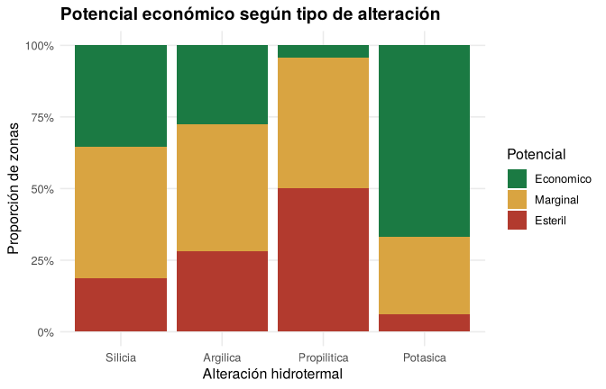
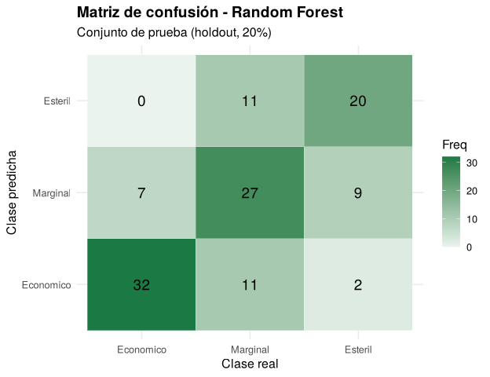
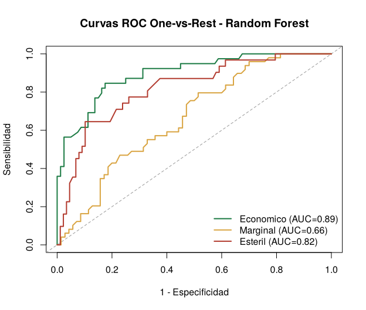

# Predicción del Potencial de Mineralización con Random Forest (R)

Modelo de Machine Learning en **R** que clasifica zonas de exploración minera según su potencial económico (**Económico / Marginal / Estéril**) a partir de variables geológicas de campo, para **priorizar dónde perforar**.



## Problema
Perforar es la etapa más costosa de la exploración minera. Este modelo usa información geológica que ya se levanta en campo (litología, alteración, estructuras, vetillas y anomalía magnética) para estimar qué zonas tienen mayor probabilidad de ser económicas antes de invertir en perforación.

## Datos
- **Volumen:** 600 zonas × 7 variables (6 predictoras + objetivo), sin valores faltantes
- **Origen:** dataset **semi-sintético**. Las 49 primeras filas provienen de la vista previa pública del notebook de Kaggle *"Predicción de Potencial de Mineralización"* (Ignacio Zambrano C.), y las 551 restantes se generaron de forma reproducible con un modelo geológico simplificado que respeta la distribución de clases original. El detalle está en la sección 0.2 del reporte.
- **Validación:** división estratificada 80/20 y validación cruzada de 10 particiones

## Resultados (conjunto de prueba)

| Métrica | Random Forest | Baseline* |
|---|---:|---:|
| **Recall – clase Económico** | **82.1 %** | — |
| **F1 – clase Económico** | **76.2 %** | — |
| Precision – clase Económico | 71.1 % | — |
| Accuracy global | 66.4 % | 41.2 % |
| AUC-ROC (Hand & Till) | 0.796 | 0.50 |

\* Baseline: predecir siempre la clase mayoritaria.

**Conclusiones clave**
- El modelo **detecta 8 de cada 10 zonas realmente económicas** (Recall de 82.1 %), que es el KPI más importante para no descartar zonas valiosas.
- La **alteración hidrotermal** (Chi² = 149.8, p < 0.001) y la **densidad de vetillas** son las variables más determinantes, tanto en el EDA como en el modelo.
- El Random Forest **supera al árbol de decisión base** en accuracy (66.4 % vs 57.1 %), Kappa y F1, y casi duplica la exactitud del baseline.
- La validación cruzada estima una exactitud de ~50 %, que es una referencia más conservadora que el conjunto de prueba (119 zonas). Incorporar más datos reales de campo es la principal vía de mejora.

<p align="center">
  
  
</p>

## Metodología
1. **EDA:** distribuciones, calidad de datos, correlaciones y pruebas **Chi-cuadrado** de asociación.
2. **Modelado:** árbol de decisión (CART) como base y **Random Forest multiclase** (500 árboles), con `mtry` elegido por validación cruzada (`caret`).
3. **Evaluación:** matriz de confusión, Precision/Recall/F1 por clase, **AUC-ROC One-vs-Rest**, curva de aprendizaje y comparación contra los KPIs de negocio.
4. **Despliegue:** **API REST con `plumber`** que recibe las variables de una zona y devuelve su clase y probabilidades ([`src/plumber_api.R`](src/plumber_api.R)).

## Herramientas
R · R Markdown · randomForest · caret · rpart · partykit · pROC · ggplot2 · plumber

## Estructura
```
├── analysis/
│   └── mineral_potential.Rmd      # análisis completo (código fuente)
├── data/
│   └── dataset_mineria.csv
├── models/
│   └── modelo_rf.rds              # modelo entrenado
├── reports/
│   ├── mineral_potential.md       # reporte visible en GitHub
│   ├── mineral_potential.html     # reporte interactivo (descargar y abrir)
│   └── mineral_potential_files/   # gráficos
└── src/
    └── plumber_api.R              # API de predicción
```

📄 **[Ver el reporte completo](reports/mineral_potential.md)**

## Cómo ejecutarlo
1. Instala los paquetes en R:
   ```r
   install.packages(c("randomForest", "rpart", "partykit", "caret", "pROC",
                      "ggplot2", "reshape2", "scales", "e1071", "rmarkdown", "plumber"))
   ```
2. Abre `analysis/mineral_potential.Rmd` en **RStudio** y presiona **Knit**.
3. Para levantar la API, desde la raíz del repositorio:
   ```r
   plumber::plumb("src/plumber_api.R")$run(port = 8000)
   ```

---
**Diego Yeferson Quispe Huamani** · Estudiante de Big Data y Ciencia de Datos – Tecsup
[LinkedIn](https://www.linkedin.com/in/di-yeferson) · [GitHub](https://github.com/di-yeferson)
